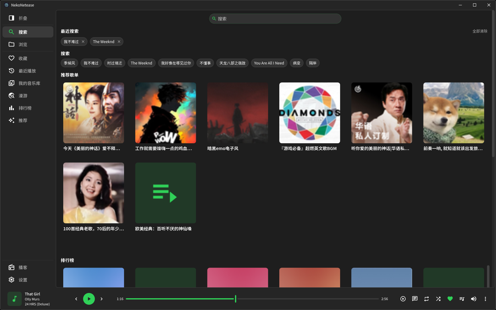
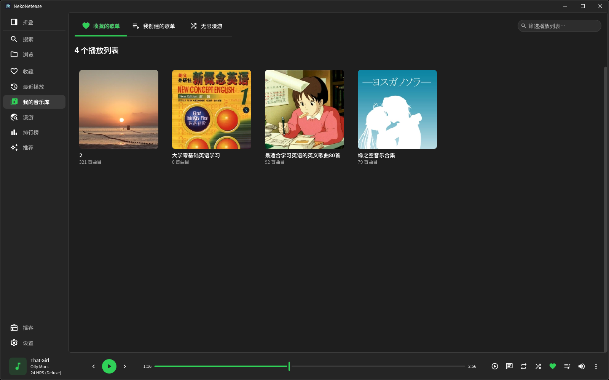
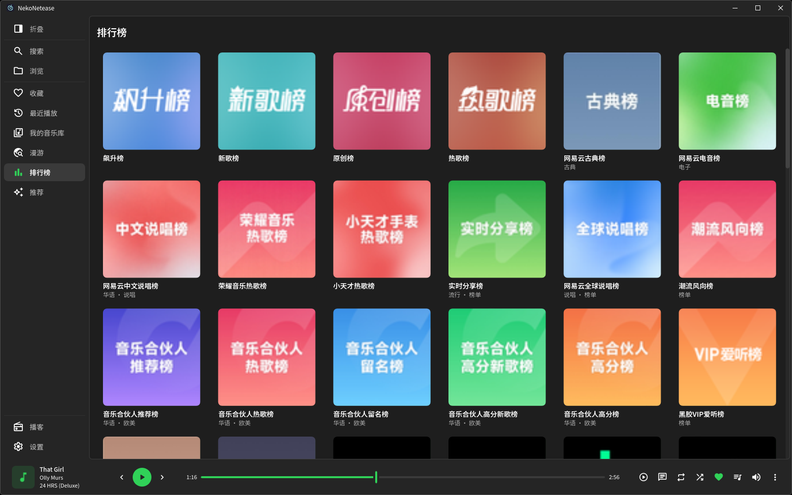
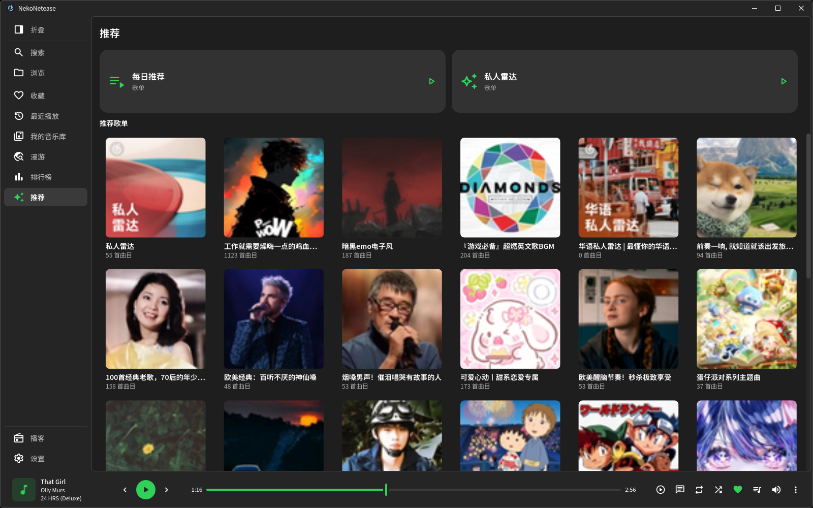
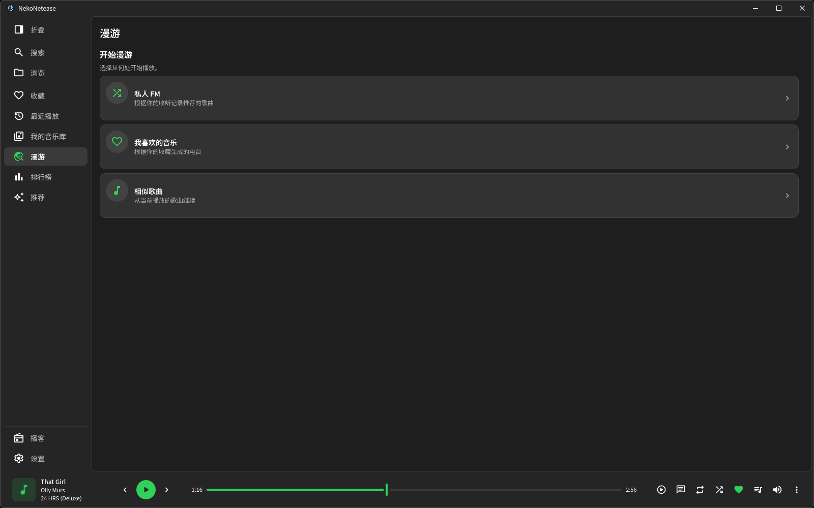
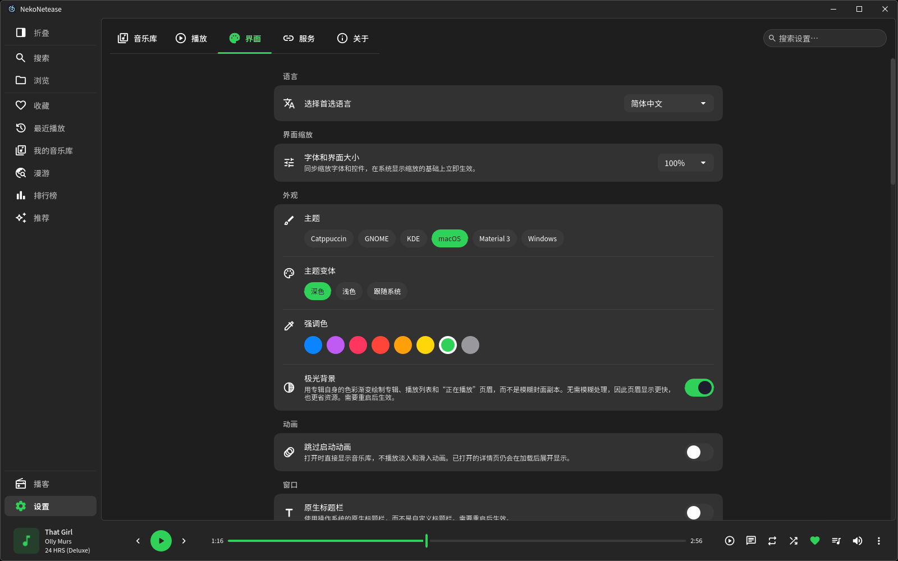

<div align="center">


# NekoNetease

**用 Rust 与 Slint 写成的网易云音乐桌面客户端 —— 原生渲染，没有 WebView。**

[](https://github.com/NekoRain404/NekoNetease/actions/workflows/release.yml)
[](LICENSE)
[](https://www.rust-lang.org/)
[](https://slint.dev/)
[](#下载与安装)
[](#版本状态)

[功能](#功能一览) · [截图](#截图) · [下载](#下载与安装) · [构建](#从源码构建) · [架构](#项目结构) · [文档](#文档) · [贡献](#贡献)

</div>

> **第三方项目声明**：NekoNetease 由社区独立开发，与网易云音乐及其关联公司无隶属、授权或官方支持关系。
> 账号、接口、曲库与播放权限均由相关服务提供方管理，服务规则或接口变化可能影响部分功能。请遵守服务条款并合理使用。

NekoNetease 基于 [Kenan Salar 的 Melodia](https://github.com/KenanSalar/Melodia) 的播放器内核演进而来，
在其本地曲库、解码与桌面集成之上补齐了网易云音乐的账号、曲库浏览、在线播放、评论与 MV 链路。
整个界面由 Slint 与 FemtoVG 直接绘制，进程内没有浏览器引擎，也不存在前后端之间的 IPC 桥。

## 截图

<div align="center">

| 搜索与发现 | 我的音乐库 |
| --- | --- |
|  |  |

| 排行榜 | 推荐 |
| --- | --- |
|  |  |

| 漫游 | 设置 |
| --- | --- |
|  |  |

</div>

> 截图来自 `0.2.0` 的 Linux 构建，主题为 Catppuccin Mocha；任意主题、变体与强调色都可以在设置里切换。

## 功能一览

| 领域 | 能力 |
| --- | --- |
| **账号** | 二维码、手机号、邮箱与短信验证码登录；风控提示、云贝、每日签到、登录设备管理 |
| **搜索与发现** | 歌曲／专辑／歌手／歌单四类搜索，Top Result、搜索建议与热搜；推荐歌单与排行榜矩阵；推荐、漫游、榜单各自独立成页 |
| **在线曲库** | 收藏与创建的歌单、我喜欢的音乐、最近播放、每日推荐、私人 FM、心动与相似歌曲漫游；歌单可新建、改名、删除、拖拽排序、编辑描述／标签／封面 |
| **播放** | 云端流媒体播放与音质分档（实际下发档位显示在 Now Playing 芯片上）；试听、会员、购买与版权不可用的分类提示与重试；无缝播放与交叉淡入 |
| **MV** | 独立 MV 页面：清晰度切换、可拖动时间轴、全屏、音量与静音、快捷键、相似 MV 侧栏，以及点赞／收藏／分享／下载与整页评论 |
| **评论与社交** | 云专辑、歌单、歌曲、MV 的完整评论线程（热门／最新、分页、回复、发表、删除、点赞、头像）；用户主页、关注、动态、私信与通知 |
| **播客** | DJ 电台推荐、电台详情与订阅、节目列表与节目播放 |
| **云盘与离线** | 云盘歌曲列表、云盘与本地曲目对应识别、复核式云端歌单同步、有上限与过期的流媒体离线缓存、MV 视频缓存 |
| **歌词** | 在线歌词、本地 `.lrc`、音频内嵌歌词，卡拉 OK 式逐行高亮，罗马音与翻译 |
| **本地音乐** | 扫描与管理本地曲库，标签编辑，封面与歌词内嵌，智能歌单，M3U8 导入导出 |
| **声音** | 10 段均衡器、ReplayGain、限幅器、交叉淡入、可视化频谱、输出设备与采样率选择 |
| **桌面集成** | 系统托盘、媒体按键（MPRIS／SMTC）、迷你播放器、文件关联、单实例、后台托盘关闭、自动更新 |
| **外观** | Catppuccin 四种变体、Windows Fluent、KDE Breeze、GNOME Adwaita、Material You 取色、自定义强调色、极光背景、无边框窗口与自绘标题栏 |
| **国际化** | 16 种界面语言，可在运行时切换 |

网易云音乐功能需要网络连接。部分歌曲、音质或账号功能可能受账号状态、会员权限、地区及服务端策略限制。

## 下载与安装

前往 [GitHub Releases](https://github.com/NekoRain404/NekoNetease/releases) 下载对应系统的构建（当前仅提供 `x86_64`）。

| 平台 | 格式 | 说明 |
| --- | --- | --- |
| Linux | `.tar.gz` | 解压后执行目录内的 `./install-linux.sh`，安装到 `~/.local/share/NekoNetease`，不需要 root |
| Linux | `.AppImage` | `chmod +x` 后直接运行 |
| Linux | `.rpm` / `.deb` | 用 `dnf` / `apt` 安装，由包管理器负责升级 |
| Windows | `.msi` | 按机器安装到 `Program Files`，注册开始菜单快捷方式与音频文件关联（0.2.0 暂未产出，见下） |
| Windows | `.zip` | 便携版，解压即用（0.2.0 暂未产出，见下） |

每个发布附件都带有 minisign 签名，发布页同时提供 `SHA256SUMS.txt` 与 GitHub 构建溯源证明；
应用内的更新来自同一份签名清单，只会接受与自身签名公钥匹配的包。

`aarch64` 暂不受支持：它不在发布矩阵里，且打包脚本、RPM／AppImage 工具链与产物命名都按 `x86_64` 写死，
移植需要这些步骤一起改动，而不只是增加两个矩阵槽。

`0.2.0` 只发布 Linux 产物。MV 播放引入 libmpv 之后，Windows 包还需要 `mpv.lib` 与随包的 DLL，
CI 尚未准备这两样；Windows 上仍会跑一次全目标编译检查。Linux 侧 libmpv 由发行版提供
（Debian／Ubuntu 的 `libmpv2`、Fedora 的 `mpv-libs`），没有它应用照常启动，只是 MV 不可用。

## 从源码构建

项目使用 Rust 2024 edition，跟随宿主 stable 工具链，最低要求 Rust 1.99（见 [`rust-toolchain.toml`](rust-toolchain.toml)）。

```bash
git clone https://github.com/NekoRain404/NekoNetease.git
cd NekoNetease
cargo run -p nekonetease            # 开发构建，使用独立的 NekoNetease-dev 数据目录
```

发布构建：

```bash
cargo build --locked --release -p nekonetease
```

Linux 侧的系统依赖（Debian／Ubuntu）：

```bash
sudo apt install libdbus-1-dev libasound2-dev libxkbcommon-dev libfontconfig1-dev \
                 libfreetype-dev libwayland-dev libssl-dev pkg-config libmpv-dev
```

（Fedora 请替换为对应的 `-devel` 包，MV 解码需要 `mpv-libs-devel`。）Windows 无需额外的项目专用依赖。

提交前的四道门禁与 CI 一致：

```bash
cargo fmt --all --check
cargo clippy --all-targets --locked --workspace -- -D warnings
cargo test --locked --workspace
cargo build --locked -p nekonetease
```

## 项目结构

根目录是虚拟 workspace，成员位于 `crates/`，依赖方向只能由外向内：

| crate | 职责 |
| --- | --- |
| `nekonetease` | 二进制入口：启动顺序、单实例、关闭与重启 |
| `nekonetease-ui` | 全部 Slint 源码、字体、图标与 15 份翻译目录 |
| `nekonetease-views` | UI 的 Rust 半边：视图状态、回调与桥接，不直接接触数据库或网络 |
| `nekonetease-app` | 应用层：库 API、设置、任务、通知、更新器 |
| `nekonetease-store` | SQLite（SQLx），迁移与两池读写 |
| `nekonetease-net` | HTTP 原语与第三方目录客户端（电台、歌词） |
| `nekonetease-engine` | 播放状态机、队列与传输 |
| `nekonetease-playback` | 解码器之上的播放链：DSP、两套 deck、输出与设备 |
| `nekonetease-audio` | 音源抽象与 Symphonia 解码 |
| `nekonetease-video` | libmpv 的 MV 播放与帧交付 |
| `nekonetease-artwork` | 图片解码、封面缓存与取色 |
| `nekonetease-platform` | 操作系统面：托盘、分配器、日志、崩溃报告、桌面集成 |
| `nekonetease-integrations` | 听歌上报、Discord 状态、系统媒体控制 |
| `nekonetease-core` | 实体、错误、工具与主题注册表 |
| `nekonetease-testkit` | 测试与语料遍历的共享工具 |

架构决策记录在 [`docs/adr/`](docs/adr/)，开发约束在 [`CLAUDE.md`](CLAUDE.md) 与 [`.claude/rules/`](.claude/rules/)。

## 文档

| 文档 | 内容 |
| --- | --- |
| [`docs/adr/`](docs/adr/README.md) | 架构决策记录：选了什么、放弃了什么、代价是什么 |
| [`docs/PROJECT_HANDOFF.md`](docs/PROJECT_HANDOFF.md) | 交付状态、工作区配置、发布链与接手须知 |
| [`docs/NETEASE_FEATURE_AUDIT.md`](docs/NETEASE_FEATURE_AUDIT.md) | 网易云功能审计与缺口清单 |
| [`docs/netease-api.md`](docs/netease-api.md) | 非官方接口与加解密说明 |
| [`docs/DEVELOPMENT_NOTES.md`](docs/DEVELOPMENT_NOTES.md) | 日常开发中最容易造成回归的约束 |
| [`CLAUDE.md`](CLAUDE.md) | 仓库级开发规范总览 |
| [`CHANGELOG.md`](CHANGELOG.md) | 版本变更记录 |

## 版本状态

当前版本 **0.2.0**，是首个预发布候选。与 `0.1.5` 相比，这一版补齐了 MV 播放页与评论区的交互、
搜索页的卡片矩阵布局，并把推荐、漫游、榜单拆成独立页面。

已知限制：

- 仅构建 `x86_64`；`aarch64` 需要打包链路一起改动。
- 地区受限的歌曲只能报告“不可用”，服务端不在响应里区分地区。
- 搜索的多种结果无法合并成统一的相关度排序，接口没有提供这一信息。

## 贡献

欢迎 issue 与 PR。开始之前请读 [`CONTRIBUTING.md`](CONTRIBUTING.md)：它会说明工具链、翻译目录的
重新生成方式，以及为什么结构性改动应该先开一个 issue。

## 许可与致谢

NekoNetease 按 [GNU Affero 通用公共许可证 v3 或更高版本（AGPL-3.0-or-later）](LICENSE) 发布。
随附的第三方组件许可文本见 [`licenses/`](licenses/)。

- 播放器内核、界面骨架与工程约定源自 [Kenan Salar 的 Melodia](https://github.com/KenanSalar/Melodia)，
  感谢 Kenan Salar 与 Melodia 的贡献者。
- 界面字体为 [Vazirmatn](https://github.com/rastikerdar/vazirmatn)（OFL）与 Material Symbols Rounded（Apache-2.0），
  图标字体经过子集化处理。
- 网易云音乐及相关商标、服务和内容归其各自权利人所有，本项目不主张相关权利。
